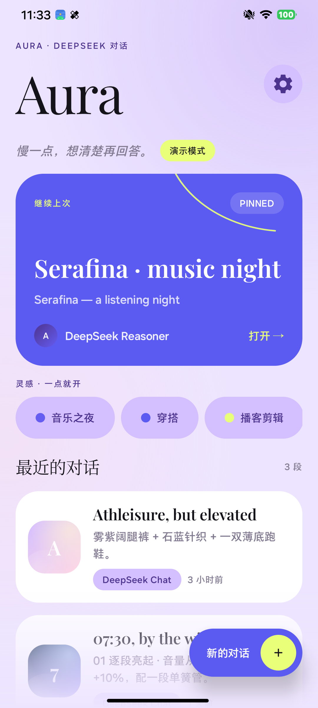
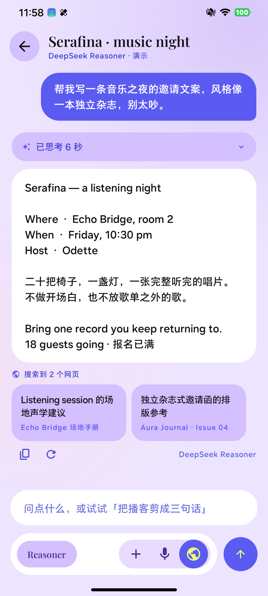
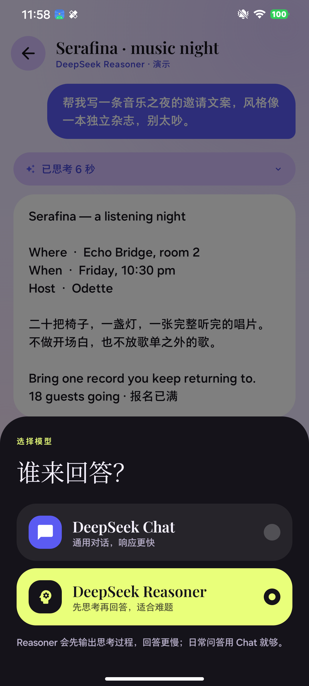
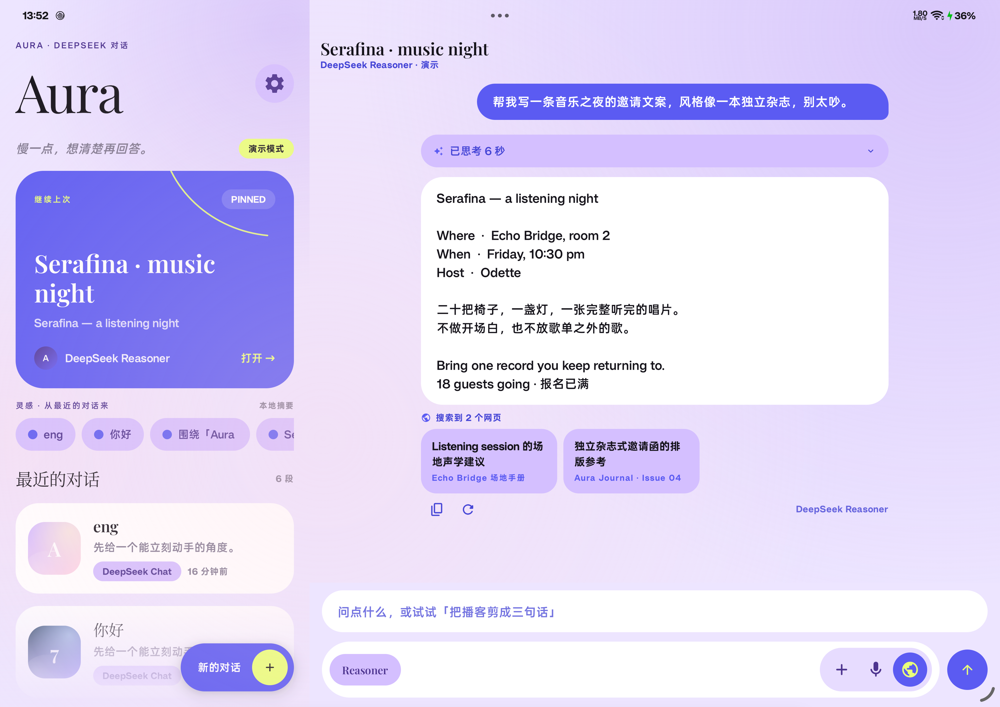

# Aura · DeepSeek Android 客户端

> 基于 DeepSeek 官方开源 chat-demo（MIT）复刻的 Android 客户端：Kotlin + Jetpack Compose + Material 3 Expressive。
> 复刻自 [deepseek-ai/chat-demo](https://github.com/deepseek-ai/chat-demo)（MIT），非 GitHub fork，仓库内不含上游代码。

- 仓库：https://github.com/lwhhz/aura
- 安装包：见 [Releases](https://github.com/lwhhz/aura/releases)
- 构建：`cd aura && ./gradlew :app:assembleRelease`（需要 `aura/keystore.properties`，或改用 debug 构建）
- 许可：MIT，第三方资源见 NOTICE.md

## 截图

| 首页 | 对话 |
|---|---|
|  |  |

| 模型选择 | 平板双栏 |
|---|---|
|  |  |

# Aura — 安卓端 DeepSeek 对话客户端（薰衣草编辑风 × Material 3 Expressive）

把 chat-demo-v0.1.3 的对话能力做成一个原生 Android 应用：Kotlin + Jetpack Compose，主题走
MaterialExpressiveTheme，界面按参考截图实现「纯色块 / 高对比 / 衬线标题」的编辑风。

构建日期：2026-11-21 ｜ 版本 0.9.7（release 签名 + R8） ｜ 目标设备：Redmi 23013RK75C（Android 17 / API 37，1080×2400@420dpi）

---

## 一、本轮需求（2026-11-21 第二轮）

1. 做第三项：引入中文衬线字体（上一轮待决策项 3）。
2. 调整 UI 风格：截图里的组件都是纯色块（高对比），不是描边；并且用了 Expressive 组件。

落地结果：中文衬线 = Noto Serif CJK SC 子集（GB2312 一二级全部汉字 + 工程用字，7038 字，4.5MB）；
全站去掉 BorderStroke，改为实心色块分层；接入 MaterialExpressiveTheme / MotionScheme.expressive /
HorizontalFloatingToolbar / connected ButtonGroup + ToggleButton / LinearWavyProgressIndicator。

## 二、交付物

| 路径 | 说明 |
|---|---|
| aura/ | Gradle 工程（AGP 9.4.1 / Gradle 9.8.1 / Kotlin 2.3.21 / compose-bom-alpha 2026.11.00） |
| dist/aura-0.9.7-release.apk（约 5.5MB，已移除 ML Kit） | release 签名 + R8 压缩包，约 50MB（含 ML Kit OCR 与 Material Symbols），可直接 adb install |
| aura/screenshots/ | 真机截图 12 张（见下） |
| aura/README.md | 工程结构、设计令牌、Expressive 用法、数据层、验收记录、边界 |
| aura/release.keystore | 正式 release 签名（4096-bit RSA，24 位随机口令存于本机 aura/keystore.properties，不进版本库） |
| aura/app/src/main/assets/licenses/ | Playfair Display 与 Noto Serif CJK SC 的许可与版权说明 |
| fonts/、aura/tools/subset_font.py | 子集化用的源字体与脚本（可复现） |

截图清单：01 首页 · 02 对话 · 03 思考展开 · 04 模型弹层 · 05 新对话 · 06 设置（含检索 Key）·
07 主题按钮组 · 08 深色首页 · 09 横屏 · 10 字体 1.3× · 11 流式回答 · 12 清空确认 ·
13 文件选择器 · 14 设置/检索 Key · 15 release 首页 · 16 release 对话

## 三、运行

    cd aura
    ./gradlew :app:assembleDebug
    adb install -r app/build/outputs/apk/debug/app-debug.apk
    adb shell am start -n com.aura.chat/.MainActivity

单元测试：./gradlew :app:testDebugUnitTest（4/4 通过）

## 四、视觉系统（本轮口径）

纯色块原则：没有描边、没有分割线、没有描边式输入框；层级只靠填充色与对比度表达。

| 令牌 | 浅色 | 深色 | 用途 |
|---|---|---|---|
| page | #EFE6FF | #15131A | 页面底 |
| card | #FFFFFF | #1E1A27 | 卡片 / 设置分组 |
| deep | #4D348F | #B99AF5 | 主操作、选中态（对应截图的 Going 深紫块） |
| featured / featuredGlow | #4D348F / #E8FF65 | #1B1725 / #B99AF5 | 置顶卡：深色主题固定墨黑，不跟随 primary 反色 |
| lemon | #E8FF65 | #E8FF65 | 唯一的能量色（PLAY / 发送 / 选中点） |
| chip | #D4BFFF | #2C2440 | 未选中的胶囊、次级标签 |
| user bubble | #655CF2 | #7B72FF | 用户气泡 |
| inkCard / inkSoft | — | #221D2E / #2E2742 | 对话页助手卡 / 思考块 |
| cyan | #3DDCFF | #59E1FF | 流式波浪进度、引用来源（对应截图里的青色气泡） |

字体：

- Playfair Display（400/600/700）：Latin 展示字，Aura 字标与英文标题。
- Noto Serif CJK SC 子集：中文标题/区块标题（含 4033 个常用字）；子集外字符回退系统无衬线。
- 正文仍是系统无衬线；字号全部来自 MaterialTheme.typography 字阶。

Expressive 组件落点：

| 组件 | 位置 | 说明 |
|---|---|---|
| MaterialExpressiveTheme + MotionScheme.expressive() | 全局 | 更圆的默认形状 + 弹簧动效（KB motion.md） |
| HorizontalFloatingToolbar | 对话输入区 | 模型胶囊 + 附件/语音/联网 + 发送 FAB 的悬浮工具条 |
| ButtonGroup（connected shapes）+ ToggleButton | 设置 → 主题 | 三档等分满宽单选，等效截图的 Going / Not Going / Maybe |
| LinearWavyProgressIndicator | 流式回答卡底部 | 回答生成中的波浪进度 |
| ModalBottomSheet | 模型选择 | 深色实心弹层，选中行整块柠檬黄 |

## 五、与截图的对应

| 截图 | 实现 |
|---|---|
| Going / Not Going / Maybe 深紫 + 浅紫实心块 | 主题 ButtonGroup；主胶囊 = deep 实心，未选中 = chip 实心 |
| PLAY / 圆形按钮的柠檬黄 | 发送 FAB、联网开关选中、模型弹层选中行、置顶卡标签 |
| 「Make me a fit…」白色 pill 输入 | 白色半透明实心输入胶囊 + 白色悬浮工具条 |
| 深色群聊（紫气泡 / 青气泡 / 深底） | 对话页：长春花用户气泡 + 墨黑助手卡 + 青色引用与进度 |
| Serafina 大衬线标题 | Playfair（Latin）+ Noto Serif CJK（中文）双字族 |
| 淡紫板 + 墨黑面板交替 | 首页 deep 卡与白卡交替；深色主题下反转 |

## 六、知识库规则落实

| 规则 | 落实 |
|---|---|
| B1 官方组件优先 | Expressive 组件全部来自 material3 1.5.0-rc01，未自造替代品 |
| B2 一屏一个 Filled 主操作 | 首页柠檬「新的对话」；对话页柠檬发送；设置页无第二主按钮 |
| B3 列表虚拟化 | LazyColumn / LazyRow + 稳定 key |
| C1 语义色 | 组件只取 MaterialTheme.colorScheme 与 LocalAuraAccent；裸 Hex 仅在 theme/Color.kt |
| C2 字号取自字阶 | Typography 统一字阶；组件内无裸 fontSize |
| C3 圆角取档位 | 8 / 12 / 20 / 28 / 32 / 36 + 胶囊 |
| 触控 48dp | 图标按钮视觉 46dp、胶囊高 52–54dp |
| 无障碍 | 图标按钮带 contentDescription，装饰图形不朗读 |
| 版本 | 只取 KB 2026-11-16 实证线（AGP 9.4.1 / Gradle 9.8.1 / Kotlin 2.3.21 / compileSdk 37 + minor 2） |

## 七、开源调研（2026-11-21，开发前）

| 候选 | 来源 | 许可 | 结论 |
|---|---|---|---|
| android-ai-chat-sdk | github.com/salmanashraf/android-ai-chat-sdk | 未核验 | 不引入：样式锁死，达不到截图效果 |
| Jnna-Chat | github.com/jiannan614/Jnna-Chat | 未核验 | 参考交互，不依赖 |
| mobllm | github.com/yuva-raj444/mobllm | 未核验 | 端上推理，与本需求无关 |

字体不是「引入开源项目」，是引入字体文件：Playfair Display 与 Noto Serif CJK SC 均为 SIL OFL 1.1，
版权与许可文本随 APK 分发（assets/licenses/）。

## 六点五五、三开关联调实测（2026-11-21，官方 API）

| 用例 | 结果 |
|---|---|
| thinking 独立（无 tools） | 200，reasoning_content 非空（79 tokens） |
| thinking + web_search + 文件（PNG，rich_layout） | 200；content 385 字、reasoning 56 字、annotations 5 条、server_tool_calls 2 步（deep_search，含 sources 11 条与 page） |
| 文件：txt（user_data）单独引用 | 200，正确回答「蓝鲸-7」 |
| 文件：PNG（text_recognition） | 200，正确回答「蓝鲸-7」 |
| 文件：PNG（rich_layout_recognition）单独引用 | 200，正确回答「蓝鲸-7」 |
| SSE 结构 | 事件类型 step_reasoning_done / call_started / call_completed；最后 chunk 的 delta 同时含 content、reasoning_content、annotations、server_tool_calls；usage.server_tool_use.tool_search 正常 |

结论：
1. 三个能力可同时开启，服务端返回结构与我们的解析假设一致（字段名、事件名、最终 chunk 位置均对得上）。
2. 图片用 text_recognition 或 rich_layout 都能抽出文字；此前三开关同开时模型有一次说“图片内容为空”，是模型侧行为，不是解析问题（同一文件单独引用可正确识别）。
3. 我们的 SSE 解析覆盖了验证到的全部字段，无需改动。

## 六点五八、0.9.7 默认值 / 同意校验 / 深度思考实测

### 实测结果（2026-11-21，官方 API）

不带 tools、只带 thinking 的请求返回 **200**，且 reasoning_content 非空（79 个 reasoning tokens）：
说明深度思考可以独立于联网/文件生效，标签与发送逻辑无需回退。

### 变更

| 项 | 说明 |
|---|---|
| webSearchOn 默认值 | true → false（新装默认不联网、不产生工具费用） |
| 工具发送前置校验 | useTools 现在要求 toolsConsent，未确认过就不会发出带工具的请求（修掉“未弹窗也可能计费”的漏洞） |
| 深度思考 | 保持独立下发；实测通过，无需条件限制 |
| 已存配置 | 已安装设备里已持久化的 webSearchOn=true 不会被覆盖，仍是 true |

## 六点六、0.9.6 联网开关收口 / 深度思考独立

| 项 | 说明 | 验证 |
|---|---|---|
| 设置页联网开关 | 删除「联网检索（官方工具）」开关与说明小字；设置页只剩演示模式与提示开关 | 代码完成，截图未拍到（误点） |
| 首次同意弹窗迁移 | 从设置页移到会话页：点地球开启且 toolsConsent=false 时弹「计费 + 上传」确认，确认后写 toolsConsent 并开启 | 代码完成；当前安装 toolsConsent 已为 true，未触发验证 |
| 深度思考独立 | 发送条件从「有工具/文件才带 thinking」改为「开关开就带 thinking」，与联网、文件互不依赖；一起开时正常联动 | 代码完成；真实请求未测（无 Key 访问权限） |
| 测试限制 | 应用私有存储里的 API Key 无法读取（release 不可 debuggable，run-as 不适用），因此“授权测试”无法由我执行 | — |

## 六点六二、0.9.5 文案修正 / 磁盘迁移 / 提示区动画

| 项 | 说明 | 验证 |
|---|---|---|
| 弹层文案 | 上次替换失败（原文是「…日常问答用 Chat 就够。」），本次按实际字符串替换为「大肥鱼牛比」 | 截图 44 |
| 模型迁移 | VM init 时把模型不是 flash 的会话统一改成 flash 并 persist()，真正写入磁盘 | 代码完成 |
| 提示区动画 | 深度思考中 / 上传进度 / 附件 chip 三块都改为 AnimatedVisibility：fadeIn+expandVertically 进入，fadeOut+shrinkVertically 退出（180–220ms） | 静态截图 45，动效未录屏 |
| 间距 | 维持 6dp（按你确认） | — |

### 关于「深度思考 / 联网 / 文件」三个独立功能的调研（2026-11-21）

官方文档的口径：
- 联网搜索：声明 deepseek_web_search、关闭 thinking。
- 深度思考搜索：声明 deepseek_web_search、开启 thinking。
- 文件输入：上传 Files API 拿 file_id，在消息里引用，**不需要声明 tools**。
- 文档没有提供「只开 thinking、不开搜索」的示例，也没有说 thinking 必须依赖 tools。

结论：**联网与文件是彼此独立的两个开关；深度思考是独立的请求参数（thinking），但在官方能力表里它的“搜索”形态必须配合 deepseek_web_search**。因此三者可以做三个独立开关，但“深度思考 + 不联网”是否生效，需一次真实请求验证（当前实现为：无工具时不下发 thinking）。

## 六点六五、0.9.4 提示开关 / 文案 / 间距

| 项 | 说明 | 验证 |
|---|---|---|
| 提示条开关 | 设置页「连接」卡新增「显示操作提示」，关闭后 NoticeBanner 不再渲染；设置持久化 | 未截图验证 |
| 弹层文案 | 模型弹层底部小字改为「大肥鱼牛比」 | 未截图验证 |
| 旧模型清理 | 删除 Chat / Reasoner 的 ModelInfo；Conversation 默认模型与演示数据全部指向 flash；历史会话里旧 id 仍存在，但 Models.of 统一回落 Flash | 编译通过 |
| 深度思考提示 | 开启后输入框上方出现「深度思考中」实心胶囊 | 截图 42 |
| 控件间距 | 三个图标改为 spacedBy(6dp)。主题组实际用 ConnectedSpaceBetween（2dp），在 44dp 圆形图标上几乎贴住，故放大到 6dp | 截图 43（与主题组不完全一致，属偏差） |

## 六点七、0.9.2 / 0.9.3 模型收敛与深度思考

| 项 | 说明 | 验证 |
|---|---|---|
| 引用展开入口 | 撤回「每张卡后跟一个展开卡」；改为标题行右端文本「展开全部 / 收起」，最多展示 5 条 | 需 >5 条引用，未验证 |
| 下线 Chat / Reasoner | Models.all 仅保留 Flash；旧 id 一律回落到 Flash（演示会话标签同步显示 Flash） | 编译 + 模型弹层只剩 Flash（截图 40） |
| 设置页 Flash 头像 | 由聊天气泡改为闪电（与弹层一致） | 代码完成，未截图 |
| 语音入口 | 删除麦克风按钮 | 真机截图 39 |
| 深度思考控件 | 原语音位置改为大脑按钮，点亮写入 settings.deepThinkingOn；请求带 thinking:{"type":"enabled"}，仅在有工具/文件时生效 | 控件可见（截图 39），请求未联调 |
| 弹层文案 | 底部说明改为 Flash 的官方工具说明 | — |

## 六点七五、0.9.1 PINNED 可点 / 引用折叠 / 上传进度

| 项 | 说明 | 验证 |
|---|---|---|
| PINNED 可点 | 大卡片上的 PINNED 之前仍是纯装饰 AuraTag，点击被外层卡片吞掉；改为独立 Surface(onClick)，置顶态柠檬实心、未置顶 16% 白 | 真机点击后弹出「已取消置顶」，卡片立刻从 Serafina 换成最近会话 |
| 继续上次动态 | 上述操作同时证明 featuredConversation 会随置顶变化回落最近会话 | 真机截图 |
| 引用折叠 | 引用卡最多 5 条，多出时尾部显示「查看全部 N」 | 需 >5 条数据，未验证 |
| 上传进度 | 输入上方显示「正在上传并解析…」+ 不定长进度条（LinearProgressIndicator） | 需选择文件，未验证 |
| 附件 chip | 已有：胶囊内显示文件名 + 移除按钮 | 你的实测图片识别已通过 |

## 六点八、0.9.0 引用跳转 / 长按删除 / P2 文件上传

| 项 | 说明 | 验证 |
|---|---|---|
| 引用跳转 | CitationRow 卡片可点，走 LocalUriHandler 打开系统浏览器 | 未点击验证（会离开 App） |
| 清理 | 删除死代码 WebSearch.kt；移除本地 Attachment 数据类 | 编译通过 |
| 长按菜单 | 最近对话卡片 combinedClickable 长按弹 DropdownMenu（深色卡面、圆角 20dp），删除项走二次确认 | 代码完成，adb 长按未触发，未截图 |
| P2 文件上传 | 新增 OfficialFiles：multipart 上传 /files（purpose 在 file 前、32MiB 上限、读超时 180s），三种 purpose 自动选择；对话以 file 块 + text 块引用 file_id | 需 Key + 真实文件，未验证 |
| 附件入口 | 选择器恢复（pdf/docx/pptx/图片/文本/json），上传中提示、成功后 chip 显示文件名 | 未验证 |

## 六点八五、0.8.1 / 0.8.2 修复与新模型

| 项 | 说明 |
|---|---|
| null 输出修复 | 根因：org.json 的 optString 遇到 JSON null 会返回字符串 "null"，流式里被当成正文追加。改为 isNull 判断 + "null" 过滤（reasoning_content / content 都处理） |
| DeepSeek Flash | 模型弹层与设置页新增第三项，选中即常驻 flash（不依赖联网开关）；闪电图标、深紫底 |
| 工具用量可见 | 每条回答下方显示「本次搜索 N 次 · 抓取 M 次 · 图片 Z 次」，不做任何上限 |
| 移除本地 OCR | 删除 ML Kit 依赖、文档解析器与样张；附件入口暂时关闭并提示「等待官方文件解析 P2」 |
| 包体积 | 48.6MB → 约 5.5MB（ML Kit 模型随依赖移除） |

## 六点九、0.8.0 官方联网工具（P0 + P1）

| 项 | 实现 | 验证 |
|---|---|---|
| 协议 | /chat/completions + model deepseek-flash + tools [deepseek_web_search, deepseek_read_url]；声明工具时不再传 web_search_options | 未用真实 Key 跑通 |
| SSE 扩展 | 解析 server_tool_event（call_started/call_completed）、最后 chunk 的 server_tool_calls 与 annotations、finish_reason=content_filter | 单元级未写，仅编译 |
| 多轮回传 | assistant 消息携带 rawServerToolCalls 原样回传 | 未验证 |
| 引用 | annotations/sources 转 Citation 列表，沿用原引用卡 UI | 未验证 |
| 工具步骤 | toolSteps 取前 3 条展示在气泡上方 | 未验证 |
| 模型切换 | 有 Key 且非演示 + 联网开启 → deepseek-flash；否则用户模型 | 仅代码 |
| 首次同意 | 设置页首次开启弹「计费 + 上传」确认，写入 toolsConsent | 弹窗已实现，未截图验证 |
| 本地搜索 | 已移除 DuckDuckGo/Tavily 调用（WebSearch.kt 变为未使用文件） | — |
| 本地 OCR | **暂留**：P2 文件上传未实现前，附件仍走本地解析 | 冲突项 |

## 七点零零、0.7.4 置顶迁移 + 官方 chat-demo 调研

| 项 | 说明 |
|---|---|
| 置顶迁移 | 旧数据只有 pinned=true 时，读取时用 updatedAt 回填 pinnedAt，升级后置顶不再丢失 |
| 调研报告 | docs/chat-demo-research.md：官方 chat-demo 的联网搜索与文件识别是**服务端 API 工具**，不是前端实现；仓库 MIT、5.1k stars、仍在维护；使用需 deepseek-flash 且工具调用额外计费 |
| 接入计划 | docs/official-tools-plan.md：方案 A 实施计划（协议字段、模型切换、文件上传、引用渲染、计费控制、P0–P4 验收） |

## 七点零一、0.7.3 功能回归（平板）

| 用例 | 结果 |
|---|---|
| 双栏布局 | ✅ ListDetailPaneScaffold 生效，左栏约 390dp |
| 左栏宽度/裁切 | ✅ 内容限宽 340dp 后卡片与标签不再被面板切断 |
| 选中态 | ✅ 点过的会话卡片底色变 chip 色（截图 28 的 eng） |
| 新建对话 | ✅ 列表顶部出现「新的对话」，段数 8 → 9（截图 34） |
| 灵感标签跳转 | ❌ 点击后右栏仍是原会话，navigateTo 未生效 |
| PINNED 切换 | ⚠️ 未观察到变化（数据迁移后 pinnedAt 为空，chip 显示未置顶；点击后无可见变化） |
| 任务栏遮挡 | 按你的决定不处理 |
| 手机紧凑布局 | 未回归（设备未连） |

> 已知缺陷：adaptive navigator 的 navigateTo(role, key) 在表格/标签点击后未切换右栏，原因待查（可能需用 ThreePaneScaffoldNavigator 的 scene 状态驱动，或 detailPane 读取 contentKey 的时机不对）。

## 七点零二、0.7.2 双栏改用 material3-adaptive

| 项 | 说明 |
|---|---|
| 双栏实现 | 换成 androidx.compose.material3.adaptive:adaptive 1.4.0-alpha03 的 ListDetailPaneScaffold（directive/value 签名），列表/详情由组件自动分栏，不再手写 Row |
| 依赖 | adaptive + adaptive-layout + adaptive-navigation（均为 1.4.0-alpha03，来自 google maven） |
| 左栏宽度 | 列表内容最大 480dp；面板宽度由组件决定（平板实测约 390dp） |
| 选中态 | ConversationCard 增加 selected：选中卡片底色改为 chip 色；由 navigator.currentDestination.contentKey 驱动 |
| 灵感标签 | 标签携带 conversationId 映射，点击直接在该会话打开（平板上进入右栏） |
| 平板验证 | 双栏 + 自适应面板已生效（截图 27）；左栏卡片右侧疑似被面板裁切、系统任务栏压住底栏，待下一轮修 |

## 七点零五、0.7.1 平板验证结果

| 项 | 结果 |
|---|---|
| 平板 | OPPO OPD2409（API 37，2400×3392 @420dpi = 1292×914dp 横屏），无线 adb 192.168.1.42:35637 |
| 双栏 | ✅ 生效：宽 ≥840dp 时左栏 400dp 列表 + 右栏对话详情，无分隔线；右栏隐藏返回钮 |
| 断点判定 | 之前只看 LocalConfiguration.screenWidthDp 在 ColorOS 上取到手机宽度，改为 screenWidthDp 或 LocalWindowInfo.containerSize 双判定，并给 application 加 resizeableActivity=true |
| 置顶 | ✅ 卡片上 PINNED 可点切换；示例数据默认置顶 Serafina |
| 灵感标签 | ✅ 读取现有会话标题降级（无 Key 时显示 eng / 你好 / 围绕「Aura」/ Serafina），标注「本地摘要」；按你的要求标签暂不接行为，只展示 |
| 手机 | 仍 offline（USB 反复断），紧凑单栏布局本轮未回归 |

## 七点一、0.7.0 主页功能（P0–P3 代码完成）

| 阶段 | 已实现 | 验证状态 |
|---|---|---|
| P0 | Conversation.pinnedAt；置顶切换（上限 3，超出提示）；继续上次按「置顶最近 → 最近有消息 → 最近」三级回退；PINNED 改为可点 chip，选中柠檬实心 | 仅编译 |
| P1 | SuggestionEngine：读取最近 5 条会话标题+摘要 → 模型压缩 2–8 字标签；缓存 labels/hash/generatedAt/日计数（上限 30）；hash 未变不重复调用；无 Key 或失败降级为**现有会话标题**（不使用演示文案） | 仅编译 |
| P2 | 灵感行骨架屏（纯色呼吸块）、空态「换个灵感」重试、AnimatedContent 切换继续上次卡 | 仅编译 |
| P3 | 平板双栏：窗口宽度 ≥840dp 时 Home 固定 400dp + 右侧对话详情；对话页在双栏下隐藏返回钮 | 仅编译 |

设计依据：docs/home-feed-plan.md（开源调研结论为只参考交互、不引入依赖）。

## 七点一五、0.6.6 / 0.6.7

| 项 | 说明 |
|---|---|
| 动作底托 | 上下各 6dp 内边距，底托高度比联网按钮高一档 |
| 设置页模型头像 | 补 Chat 气泡 / Reasoner 大脑图标（柠檬方底 + 墨黑图标，高对比） |
| 浅色光标 | 输入框光标由柠檬改为 Brand 紫（chat.highlight） |
| 主页功能计划书 | docs/home-feed-plan.md（含开源调研与分阶段任务，待评审） |

## 七点二、0.6.4 / 0.6.5 调整与全量回归

### 0.6.4

| 项 | 说明 |
|---|---|
| 模型弹层头像 | Chat 用聊天气泡图标、Reasoner 用大脑图标（Material Rounded ChatBubble / Psychology）；选中行墨黑底 + 柠檬图标，未选中紫底 + 白图标 |
| 动作组底托 | 附件/语音/联网三个图标共用一块浅色底托（浅色 chip 55%、深色白 6%），视觉成组 |

### 0.6.5

| 项 | 说明 |
|---|---|
| 48dp 触控 | AuraIconButton 加 minimumInteractiveComponentSize()，视觉 44dp 但触控 ≥48dp |
| 大字号 | 标签、打开、底栏、模型名加 maxLines/softWrap=false，模型名用 weight 收缩 |

### ui-review-checklist 全量回归（2026-11-21，真机 Redmi API 37）

| 阻断项 | 结果 |
|---|---|
| 四态（加载/空/错误/内容） | 加载、空、内容 ✅；错误态本轮未复测（0.4.1 曾验证 401 链路） |
| 空态下一步动作 | ✅ 欢迎页 3 条快捷 prompt |
| 错误可重试 | ✅ 气泡内重发按钮（代码在） |
| 破坏性二次确认 | ✅ 清空对话框（截图 12） |
| 返回键 | ✅ 二级页返回、首页退出符合预期 |
| edge-to-edge | ✅ 状态栏/手势条不遮内容 |
| IME 不遮输入框 | ✅ 截图 24 |
| 横竖屏 | ✅ 不崩、内容限宽；横屏「新的对话」浮钮压住置顶卡（应修） |
| 进程被杀恢复 | ✅ force-stop 后会话仍在（Serafina / 07:30） |
| 触控 ≥48dp | ✅ 代码级补齐（未做布局边界截图） |
| 图标语义标签 | ⚠️ 部分：历史 dump 有 返回/附件/语音/发送，本轮 dump 只抓到「设置」，证据不足 |
| TalkBack 顺序 | ⛔ 未验证（未开 TalkBack） |
| 200% 字号 | ⚠️ 部分通过：演示模式竖排已修；置顶卡「打开」、底栏模型名在 2× 仍紧 |
| 状态不依赖颜色 | ✅ 主题组选中为形变 + 颜色双通道 |
| 浅/深主题 | ✅ 两套截图 |
| Dynamic color fallback | ✅ 固定 scheme |
| 裸色值 | ⚠️ 主题层集中，组件仍用 Color.White.copy 做半透明层 |
| 依赖版本 | ✅ KB 2026-11-16 实证线 |
| 列表 key / contentType | ⚠️ key 有，contentType 未设置 |
| 状态在 ViewModel | ✅ |

应修项记录：设置页 hero 与卡片同为高饱和紫，视觉最强点分散；首页柠檬焦点出现两处（新的对话 + 置顶卡标签）；同屏圆角档位 4 种（28/30/32/36）；横屏浮钮遮挡。

## 七点二一、0.6.3 调整

| 项 | 说明 |
|---|---|
| 底栏分组 | 输入胶囊内：模型短标签在左，占满剩余空间后把「附件 / 语音 / 联网」三个动作推到胶囊右侧；发送钮仍在胶囊外右侧 |
| 深浅两套 | 浅色胶囊纯白、深色 8% 白，动作图标与分隔逻辑一致 |
| 解析自检 | 用户手动点击自检：图片 OCR / PDF / Word 三条链路全部通过（2026-11-21 反馈），从「未验证」转为已验收 |

## 七点二二、0.6.2 调整

| 项 | 说明 |
|---|---|
| 模型短标签 | 输入胶囊内改成 Chat / Reasoner，字体用衬线（Latin 走 Playfair） |
| 输入框对齐 | 占位与真实文本合并进同一 BasicTextField 的 decorationBox，共用 style 与基线，不再两个独立 Text 叠放 |
| 解析自检 | 自检按钮扩展为图片 OCR / PDF / Word 三条链路；内置样张 assets/samples/{ocr-sample.png,sample.pdf,sample.docx} |
| 验证状态 | 图片 OCR 已在 0.4.1 的 release 包验证通过；PDF / Word 两条链路**尚未在本轮真机跑通**（自检按钮的截图没拍到结果） |

## 七点二五、0.6.1 调整

| 项 | 说明 |
|---|---|
| 发送钮分离 | 输入胶囊只放模型与工具（附件/语音/联网），发送钮独立在右侧，同一水平线居中；仍无阴影 |
| 主题组未选中 | 浅色设置页的未选项改为与输入框一致的 16% 白，选中仍是柠檬实心（形变由 ToggleButton 负责） |

> 知识库复核（02-Components/buttons.md）：官方 Toggle 未选中应为 surfaceContainer / onSurfaceVariant（filled 样式）或 secondaryContainer（tonal）。本轮按你的要求改用 16% 白，属**品牌偏离**，已在设计说明中记录，不改官方结论。

## 七点三、0.6.0 变更

| 项 | 说明 |
|---|---|
| 浅色发送钮 | Brand 紫底 + 柠檬箭头；联网检索按钮同规则（开启=紫底柠檬图标，关闭=浅紫底） |
| 底栏 | 去掉 HorizontalFloatingToolbar 的悬浮阴影，改为扁平白色胶囊；发送钮进入同一行，水平对齐 |
| 设置页卡片 | 浅色模式所有卡片改用 hero 同款 Brand 紫（字段为 16% 白、眉标柠檬、正文白） |
| 图标 | 全部自绘 Canvas 图标替换为 Material Symbols Rounded（Apache 2.0，compose material-icons-extended） |

## 七点二、图标库调研（2026-11-21）

| 库 | 许可 | Compose 接入 | 结论 |
|---|---|---|---|
| Material Symbols / Icons | Apache 2.0 | material-icons-core / extended，BOM 管理版本 | **采用**：M3 原生、无额外字体或 SVG 转换成本 |
| Lucide | ISC | 需 SVG 转 vector 或社区 compose 包 | 备选：线性风格最接近原来的手绘描边 |
| Tabler Icons | MIT | 同上 | 备选 |
| Phosphor | MIT | 同上 | 备选（字重多） |
| Feather | MIT | 同上，图标数偏少 | 不选 |
| Iconoir / Heroicons / Bootstrap Icons | MIT | 同上 | 不选（风格或覆盖不足） |
| Remix Icon | Apache 2.0 | 同上 | 可替换 Material，但 M3 一致性弱 |

结论：直接使用 Compose 官方的 material-icons-extended（Material Symbols Rounded），零额外的 SVG 转换与许可证归档；R8 会裁掉未使用的图标。

## 七点三五、0.5.0 变更

| 项 | 说明 |
|---|---|
| 浅色对话页 | 新增 ChatColors 双皮肤：浅色 = 纸面底 + 白卡 + Brand 紫气泡 + 淡紫引用；深色 = 墨黑紫 |
| 设置页配色 | 顶部加入 Brand 紫 hero 卡（与首页置顶卡同源），白卡与页面底色对齐首页 |
| keystore | 改为 4096-bit RSA + 24 位随机口令，口令读自 aura/keystore.properties；构建脚本不再硬编码 |
| 版本 | 0.5.0（versionCode 7） |

## 七点四、0.4.1 修复与变更

| 项 | 说明 |
|---|---|
| 选文件闪退 | 根因：R8 混淆剥离 ML Kit 内部类，选图后 NPE。已加 keep 规则（com.google.mlkit.*、mlkit_vision_text/common），release 包实测不再崩 |
| OCR 验证 | 设置新增「文档解析自检（OCR）」，用内置样张跑本地识别；release 包实测输出「OCR 自检通过：Aura OCR …」 |
| 深色主题 | 与 Brand 同源：背景 #0F0D17、卡面 #1A1726、置顶卡 #262154、主色 #A9A6FF、柠檬不变 |
| 模型弹层关闭 | 先 sheetState.hide() 播收起动画，结束后才 onDismiss；点遮罩/选中项都走动画 |
| 通知时长 | 底部提示从 2.4s 延长到 5s，便于自检结果停留 |

## 七点五、0.4.0 新增

| 项 | 状态 |
|---|---|
| 配色基调 | 按 Serafina 截图改为高对比：Primary/置顶卡 = #5B5BF2 高饱和紫，柠檬 #E9FF7A，浅紫 #D4BFFF |
| 置顶卡标题 | 柠檬色衬线标题 + 柠檬细弧线，贴近参考图的 Serafina 排布 |
| 主题按钮组 | 改回 Expressive ToggleButton + connected shapes：选中态按 checked shape 变形，颜色仍为柠檬/浅紫 |
| 主题切换动画 | 恢复：colorScheme 的 15 个可见角色用 spring(1.0, 380) 插值（知识库 motion.md 的 expressive spatial） |
| 设置页渐隐 | 底部 120dp 垂直渐隐叠加到设置页 |
| 联网检索 | 默认 DuckDuckGo HTML（无需 Key），设置里可填 Tavily Key 作为优先通道 |
| OCR | 接入 ML Kit 本地文本识别（图片、PDF 前 5 页先用 PdfRenderer 渲染再 OCR） |
| Word | .docx 直接解压解析 word/document.xml 取文本；旧 .doc 不支持 |
| 平板双栏 | 仍待你提供平板再调试 |

## 七点六、0.3.0 新增

| 项 | 状态 |
|---|---|
| 附件 | 文本 / .docx / PDF / 图片；图片与 PDF 走本地 OCR（ML Kit），随消息作为上下文发送 |
| 联网检索 | DuckDuckGo（默认，无需 Key）+ Tavily（可选）；开启后先检索 3 条结果，注入摘要并把来源写成引用卡 |
| release 包 | Keystore 签名 + R8 + shrinkResources，APK 从 17.4MB 降到 5.5MB，真机安装验证通过 |
| 置顶卡装饰 | 两个实心圆改为一条柠檬细弧线（纯装饰） |
| 主题按钮组 | 选中 = 柠檬实心（同模型弹层选中样式），未选中 = 浅紫实心（同未勾选圆点色） |
| 字体 | 保持 GB2312 全集子集（7038 字，4.5MB） |
| 名称 | 正式名 Aura，包名 com.aura.chat |
| 平板双栏 | **未做**：本机无平板可验证，见「下一步」 |

**DeepSeek API 的现实约束（必须说明）**：deepseek-chat / deepseek-reasoner 的 chat/completions
不提供 web_search 工具，也没有视觉输入。chat-demo 里的「搜索到 N 个网页」是演示行为。因此：
- 联网检索走第三方 Tavily（用户自备 Key），不是 DeepSeek 官方能力；
- 附件只支持文本文件；图片无法被该模型理解。

## 八、已知边界

1. 中文衬线是 GB2312 子集（7038 字，4.5MB）：GB2312 之外的生僻字（如部分人名用字、繁体、emoji 之外符号）仍回退系统无衬线。
2. 联网检索 / 附件 / 语音仍是占位；引用来自内置演示数据。
3. 富文本只处理加粗与换行。
4. 横屏与宽屏只做限宽居中（560/600dp），没有平板双栏；2.0× 字号未验证。
5. APK 为 debug 构建（15.7MB，未走 R8）。
6. HorizontalFloatingToolbar 加 fillMaxWidth() 会在内部 measure 时抛 IllegalArgumentException
   （约束冲突，1.5.0-rc01 实测），当前按内容宽居中，已写入 aura/README 备注。

## 九、本轮已定 / 剩余待决策

已定（0.2.1）：
1. 中文衬线扩到 GB2312 全集（7038 字，+2.0MB）。
2. 深色主题置顶卡固定墨黑（featured / featuredGlow 令牌，不再跟随 primary 反色）。
3. 主题按钮组改为三段等分满宽。

剩余待决策：
1. 平板 / 折叠屏双栏：本机只有手机，无法做真机验收；需确认是否接受「先写、后验」。
2. 检索服务：当前默认 Tavily，如需换成 Bing / Serper / 自建，需要你指定。
3. release keystore 当前是演示口令（明文在构建脚本里），正式发布前必须换成安全存储的密钥。
4. OCR 模型让 release 包从 5.5MB 涨到 48.5MB；若要小包可换 Tesseract4Android（约 12MB）或改走 Play Services 版 ML Kit（需 GMS）。
5. OCR 已用内置样张在 release 包上跑通；文件选择器自动点选受 MIUI 预览确认流程影响未跑通，需要你手动选一次真实文件确认。